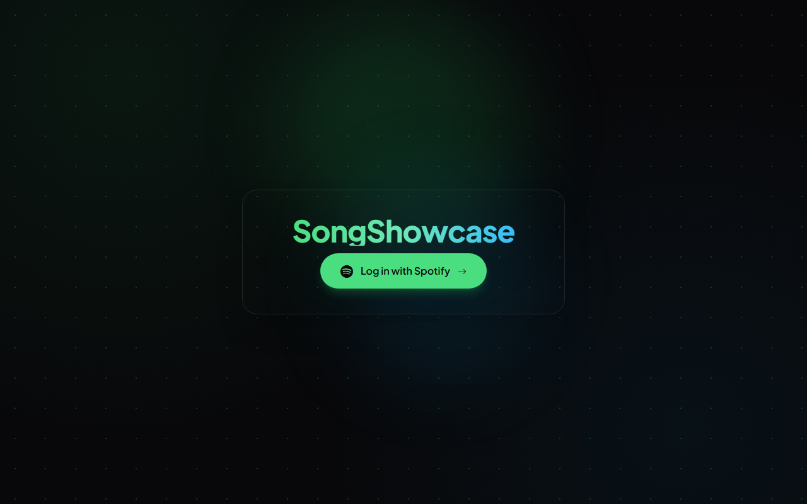

# SongShowcase

A Spotify listening dashboard built with Next.js, TypeScript, React, and MongoDB. It shows a signed-in listener's top artists and tracks across Spotify's time ranges, genre distribution, the first 50 playlists, and current playback. The playback widget displays status; it does not control playback.

This repository preserves the project's development history with private configuration and unlicensed assets removed. The release adds backend validation and tests to the original implementation. It is a portfolio project, with the operational limits described below.



The screenshot is the locally built sign-in page. It contains no account data; an authenticated dashboard has not been captured or verified against live Spotify for this release.

## Architecture and request flow

```mermaid
sequenceDiagram
    participant B as Browser
    participant N as Next.js Node backend
    participant S as Spotify
    participant M as MongoDB
    B->>N: GET /api/login
    N-->>B: State cookie + Spotify consent redirect
    B->>S: Authorize requested scopes
    S-->>B: Authorization code + state
    B->>N: GET /api/callback
    N->>N: Validate state against cookie
    N->>S: Exchange code, then fetch profile
    N->>M: Upsert minimal profile; create session with tokens
    N-->>B: Opaque session cookie; redirect /dash
    B->>N: GET /api/get?get=topArtists
    N->>M: Look up hashed session and check expiry
    N->>S: Refresh if needed; request resource
    N-->>B: JSON without Spotify tokens
```

- `app/api/`: OAuth login/callback, protected Spotify queries, explicit refresh, and logout. OAuth uses the server-side authorization code flow with a client secret. State is random, bound to an HttpOnly cookie, and cleared on callback.
- `app/lib/backend.ts`: validated configuration, session lookup, token exchange/refresh, ten-second upstream request timeouts, no-store responses, and bounded error messages. A Spotify resource 401 triggers one retry after refresh. Refresh retains the old refresh token if Spotify omits a replacement.
- `Models/`: `UserSession` stores Spotify tokens, a SHA-256 digest of the browser session token, access-token expiry, and seven-day session expiry. Requests enforce expiry; a MongoDB TTL index also cleans expired records. `UserInfo` stores a minimal profile: ID, display name, images, and external links. The connection helper caches its Mongoose connection/promise and resets failed connection attempts.
- `app/dash/` and `Components/`: server-side session gate, client-rendered lists, a genre chart, and a playback widget polling every five seconds. Spotify credentials stay on the server. Session cookies are HttpOnly, SameSite=Lax, and Secure when the configured callback uses HTTPS.

## Local setup

Use Node.js 22.12+ (Node 22 LTS is used in CI), npm, MongoDB, and a Spotify developer application.

```sh
git clone https://github.com/aryashmullick/songshowcase-public.git
cd songshowcase-public
npm ci
cp .env.example .env.local
# PowerShell: Copy-Item .env.example .env.local
npm run dev
```

Set real values in `.env.local`, then open [http://127.0.0.1:3000](http://127.0.0.1:3000). Use the same host for the site and callback so the state cookie is sent correctly.

| Variable | Purpose |
|---|---|
| `SP_CLIENT_ID` | Spotify developer application's client ID |
| `SP_CLIENT_SECRET` | Server-only Spotify client secret |
| `SP_REDIRECT_URI` | Exact registered callback, locally `http://127.0.0.1:3000/api/callback` |
| `DATABASE_URL` | MongoDB connection URI for a dedicated application database |

No Supabase account or browser-exposed environment variables are required. Never commit `.env.local`, database exports, token responses, or provider configuration.

In the [Spotify developer dashboard](https://developer.spotify.com/dashboard), create an app with Web API access and register the callback exactly. The app requests `user-top-read`, `user-read-playback-state`, `playlist-read-private`, and `playlist-read-collaborative`. Add test listeners according to your app's current development-mode requirements. Spotify's [redirect rules](https://developer.spotify.com/documentation/web-api/concepts/redirect_uri) require HTTPS outside explicit loopback IPs; `localhost` is not an accepted loopback callback. A hosted deployment needs its own HTTPS callback, server environment variables, and a restricted MongoDB database user. No hosted deployment is included in this release.

## API and validation

`GET /api/get` accepts `get=info|topArtists|topTracks|playlists|player`. Top-list queries accept `limit=1..50`, `time_range=short_term|medium_term|long_term`, and optional `analyze=true`. Artist analysis returns genre percentages. Track analysis attempts audio-feature averages and returns `analysisAvailable=false` with null averages if access is unavailable. `GET /api/refresh` refreshes the current authenticated session without returning its tokens. `POST /api/logout` requires the configured site's Origin and removes the current session.

```sh
npm run check       # lint, typecheck, mocked route tests, production build
npm run smoke       # HTTP checks against a local production server, using dummy config
npm audit           # current advisories for the locked dependency graph
gitleaks git --redact=100 --log-opts="--all --full-history" .
```

`npm test`, `npm run lint`, `npm run typecheck`, and `npm run build` can also run separately. The mock suite calls real route handlers with substituted Spotify responses and MongoDB operations; it covers state/cookies, invalid sessions, refresh rotation and failure, upstream errors, request validation, and logout. It makes no live Spotify or database requests. Smoke checks cover the login page, dashboard redirects, unauthenticated APIs, rejected callbacks, redirect configuration, and logout. See [the release review](docs/RELEASE_REVIEW.md) for audit scope and operational follow-up. CI repeats build/test/audit and history scanning; its hosted result must be checked separately.

## Known limitations

- Live OAuth consent, account eligibility, Spotify endpoint access, real MongoDB connectivity/TTL creation, and HTTPS deployment cookies remain unverified in this release. Fresh deployment sessions are required because session storage changed.
- Spotify restricts [Audio Features access](https://developer.spotify.com/blog/2024-11-27-changes-to-the-web-api). Treat the optional analysis as access-dependent; the top-track list still works when feature access is denied. Playlist pagination beyond 50 is not implemented. Recommendations and playback controls are not implemented in this release.
- Tokens are stored without application-level encryption in MongoDB. Secure the database and hosting environment before deployment. Refresh coordination is process-local; distributed locking and application-level rate limiting are not implemented.
- Logout removes the current session, not stored profiles or every other session. Account-data deletion has no UI. The interface assumes Spotify-shaped data and has not had a full accessibility or cross-device review.
- The old callback logged token responses. Rotate the old Spotify client secret and revoke old app grants if those logs may have been retained or shared. Review the old database credential before reusing it. Git cleanup does not revoke credentials. Keep access logs from recording callback query strings, cookies, or authorization headers.

## Attribution, licensing, and updates

Application code has no open-source license grant; `package.json` is marked `UNLICENSED`, preserving the original license status. Public visibility is for portfolio review. Dependencies and retained template assets have their own licenses: see [third-party notices](THIRD_PARTY_NOTICES.md). Spotify data and branding remain subject to Spotify's terms; SongShowcase is not affiliated with Spotify. The former Blanka font is excluded because its redistribution permission was not documented.

For updates, work from this public repository, keep credentials in ignored local/hosting configuration, run the checks above, and inspect staged files and outgoing commits before `git push origin main`. Regenerate notices with `node scripts/third-party-notices.mjs` when dependencies change. Port private work as reviewed patches; never merge the original private history or use a mirror/all-ref push. [More detail](docs/RELEASE_REVIEW.md#future-publication).
