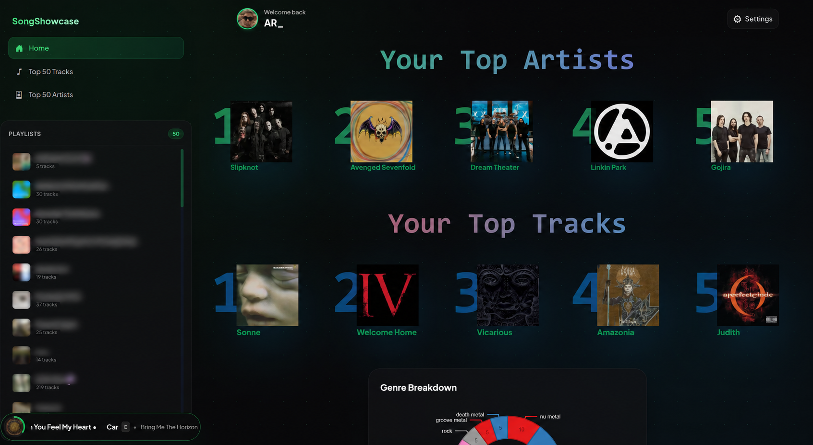
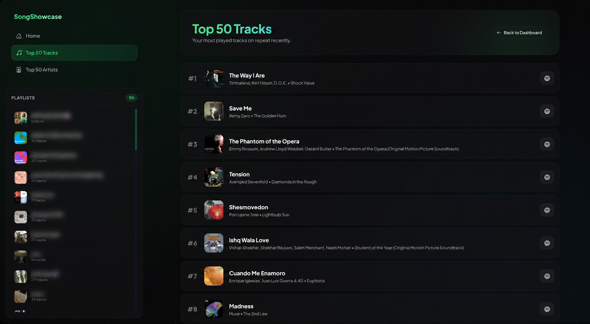
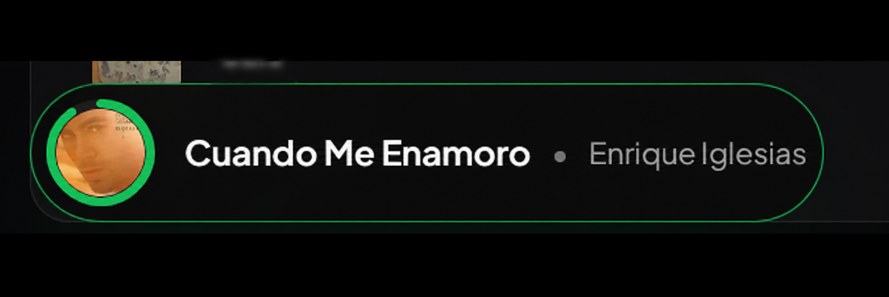
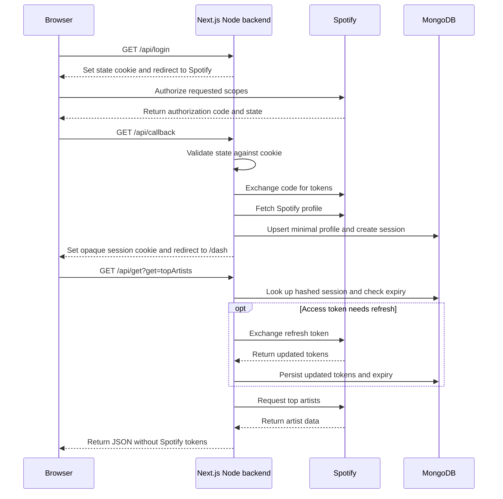

# Note
I made this project back in 2023, when I was just exploring the spotify API, NextJS and MongoDB. This project was purely made to gain knowledge along the way, and I had no intention to make it public or ship it.

This project was made with minimal use of AI in 2023, and the AI was majorly used quite recently in 2026 to:
- Sanitize the original private repository
- Update this project to follow Spotify's new API changes and fix other features which broke over the years.

Feel free to browse around and see what I was up to back then!

# SongShowcase

A Spotify listening dashboard built with Next.js, TypeScript, React, and MongoDB. It shows a signed-in listener's top artists and tracks across Spotify's time ranges, genre distribution, the first 50 playlists, and current playback. The playback widget displays status; it does not control playback.

This repository preserves the project's development history with private configuration and unlicensed assets removed. The release adds backend validation and tests to the original implementation. It is a portfolio project, with the operational limits described below.


The screenshot is the locally built sign-in page.

## Screenshots

AI tools were used to blur playlist names in the screenshots for privacy. The edited images were also resized.

### Dashboard



### Top tracks



### Playback widget



## Architecture and request flow



- `app/api/`: OAuth login/callback, protected Spotify queries, explicit refresh, and logout. OAuth uses the server-side authorization code flow with a client secret. State is random, bound to an HttpOnly cookie, and cleared on callback.
- `app/lib/backend.ts`: validated configuration, session lookup, token exchange/refresh, ten-second upstream request timeouts, no-store responses, and bounded error messages. A Spotify resource 401 triggers one retry after refresh. Refresh retains the old refresh token if Spotify omits a replacement.
- `Models/`: `UserSession` stores Spotify tokens, a SHA-256 digest of the browser session token, access-token expiry, and seven-day session expiry. Requests enforce expiry; a MongoDB TTL index also cleans expired records. `UserInfo` stores a minimal profile: ID, display name, images, and external links. The connection helper caches its Mongoose connection/promise and resets failed connection attempts.
- `app/dash/` and `Components/`: server-side session gate, client-rendered lists, a genre chart, and a playback widget polling every five seconds. Spotify credentials stay on the server. Session cookies are HttpOnly, SameSite=Lax, and Secure when the configured callback uses HTTPS.

## Local setup

Use Node.js 22.12+ (Node 22 LTS is used in CI), npm, MongoDB, and a Spotify developer application.

```sh
git clone https://github.com/aryashmullick/songshowcase-public.git
cd songshowcase-public
npm ci
cp .env.example .env.local
# PowerShell: Copy-Item .env.example .env.local
npm run dev
```

Set real values in `.env.local`, then open [http://127.0.0.1:3000](http://127.0.0.1:3000). Use the same host for the site and callback so the state cookie is sent correctly.

| Variable | Purpose |
|---|---|
| `SP_CLIENT_ID` | Spotify developer application's client ID |
| `SP_CLIENT_SECRET` | Server-only Spotify client secret |
| `SP_REDIRECT_URI` | Exact registered callback, locally `http://127.0.0.1:3000/api/callback` |
| `DATABASE_URL` | MongoDB connection URI for a dedicated application database |

No Supabase account or browser-exposed environment variables are required. Never commit `.env.local`, database exports, token responses, or provider configuration.

In the [Spotify developer dashboard](https://developer.spotify.com/dashboard), create an app with Web API access and register the callback exactly. The app requests `user-top-read`, `user-read-playback-state`, `playlist-read-private`, and `playlist-read-collaborative`. Add test listeners according to your app's current development-mode requirements. Spotify's [redirect rules](https://developer.spotify.com/documentation/web-api/concepts/redirect_uri) require HTTPS outside explicit loopback IPs; `localhost` is not an accepted loopback callback. A hosted deployment needs its own HTTPS callback, server environment variables, and a restricted MongoDB database user. No hosted deployment is included in this release.

## API and validation

`GET /api/get` accepts `get=info|topArtists|topTracks|playlists|player`. Top-list queries accept `limit=1..50`, `time_range=short_term|medium_term|long_term`, and optional `analyze=true`. Artist analysis returns genre percentages. Track analysis attempts audio-feature averages and returns `analysisAvailable=false` with null averages if access is unavailable. `GET /api/refresh` refreshes the current authenticated session without returning its tokens. `POST /api/logout` requires the configured site's Origin and removes the current session.

```sh
npm run check       # lint, typecheck, mocked route tests, production build
npm run smoke       # HTTP checks against a local production server, using dummy config
npm audit           # current advisories for the locked dependency graph
gitleaks git --redact=100 --log-opts="--all --full-history" .
```

`npm test`, `npm run lint`, `npm run typecheck`, and `npm run build` can also run separately. The mock suite calls real route handlers with substituted Spotify responses and MongoDB operations; it covers state/cookies, invalid sessions, refresh rotation and failure, upstream errors, request validation, and logout. It makes no live Spotify or database requests. Smoke checks cover the login page, dashboard redirects, unauthenticated APIs, rejected callbacks, redirect configuration, and logout. See [the release review](docs/RELEASE_REVIEW.md) for audit scope and operational follow-up. CI repeats build/test/audit and history scanning; its hosted result must be checked separately.

## Attribution, licensing, and updates

Application code has no open-source license grant; `package.json` is marked `UNLICENSED`, preserving the original license status. Public visibility is for portfolio review. Dependencies and retained template assets have their own licenses: see [third-party notices](THIRD_PARTY_NOTICES.md). Spotify data and branding remain subject to Spotify's terms; SongShowcase is not affiliated with Spotify. The former Blanka font is excluded because its redistribution permission was not documented.

For updates, work from this public repository, keep credentials in ignored local/hosting configuration, run the checks above, and inspect staged files and outgoing commits before `git push origin main`. Regenerate notices with `node scripts/third-party-notices.mjs` when dependencies change. Port private work as reviewed patches; never merge the original private history or use a mirror/all-ref push. [More detail](docs/RELEASE_REVIEW.md#future-publication).
